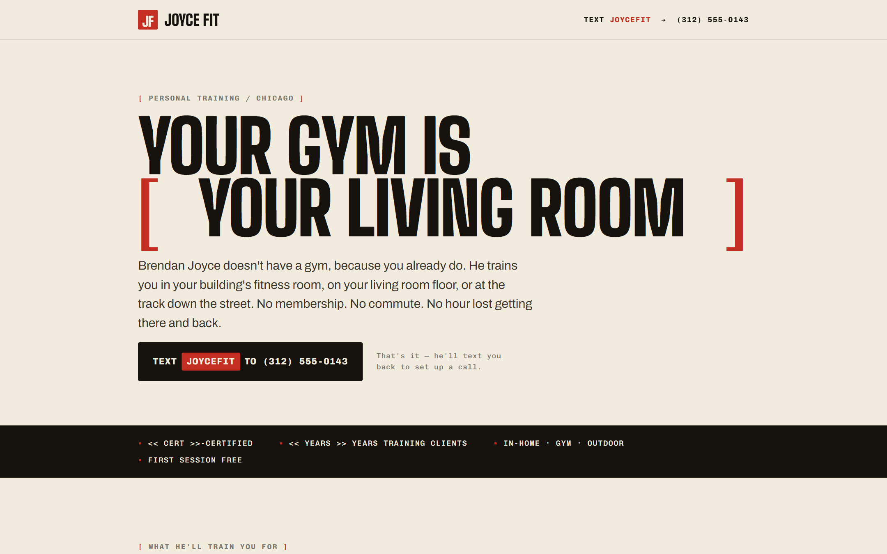
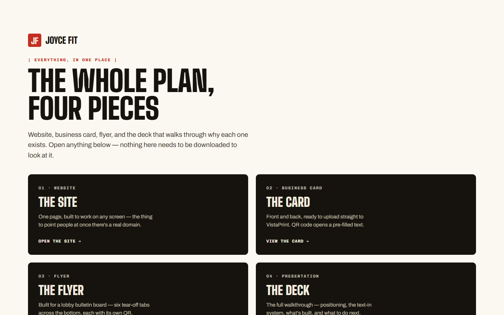
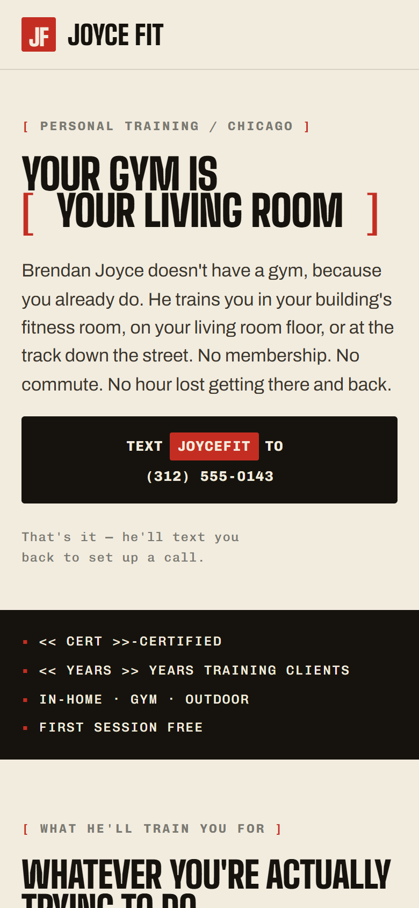
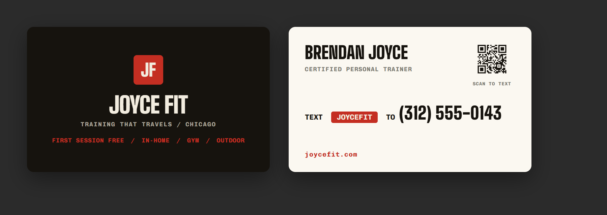
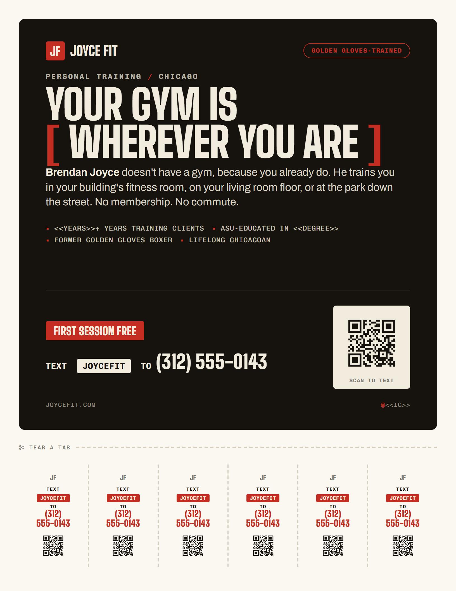
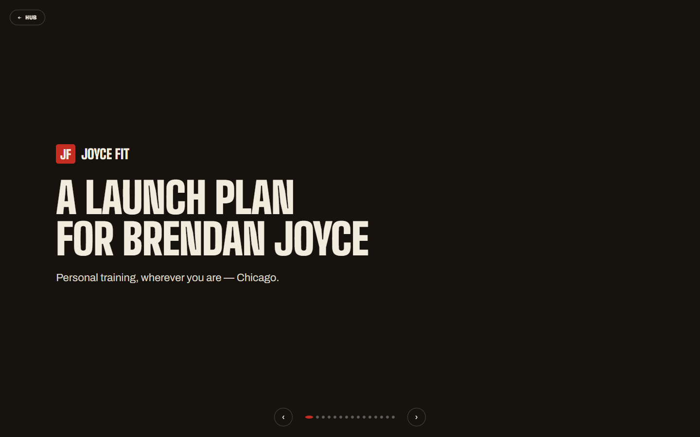

# JoyceFit

A complete launch kit for a Chicago in-home personal trainer: one-page website, print-ready business card and tear-tab flyer, logo set and a pitch deck, all static HTML with self-hosted fonts.

   



Try it: clone the repo and open `index.htm` in a browser. Nothing needs a build step or a server.

## Why

- Launch a one-person training business with every customer-facing piece already designed to match.
- One action everywhere: the site, the card and the flyer all say "Text JOYCEFIT", so every lead arrives the same way.
- Send the card and flyer straight to the printer: the PDFs are already sized with bleed.
- Look the same on every machine: the fonts ship with the repo, so nothing depends on a third-party font service.
- Hand the owner a deck that explains why each piece exists and what to do next.

## Features

The hub page (`index.htm`) links the four pieces.



### Website

`frontpage.htm` is a single responsive page: hero with a rotating location word ("your living room", "the park at 7am", "the lakefront path", and more; it shows one fixed phrase when the visitor prefers reduced motion), credentials strip, three training goals, three places to train, a four-step "how it starts", a rates table and a closing call to action. The call to action is an `sms:` link with `JOYCEFIT` pre-filled.



### Business card

`card.htm` previews the front and back; `joycefit-businesscard-PRINT.pdf` is the print file for a standard 3.5 x 2 inch card with bleed included. The QR code opens a text message with JOYCEFIT pre-typed.



### Flyer

`flyer.htm` is a US Letter flyer (`@page` 8.5 x 11 in) for a lobby bulletin board, with six tear-off tabs that each carry the number and their own QR code. `joycefit-flyer-PRINT.pdf` is the print file.



### Deck

`deck.htm` is a 15-slide, full-screen presentation: the idea, why trust him, the text-in system, the offer, the phone number, what's built (brand, website, card, flyer), where to post first, social, other ways to grow, what is needed from the client, and next steps. Slides scroll-snap; arrow keys and Page Up/Down move between them, and printing gives one slide per page.



### Brand

| File | Use |
|---|---|
| `joycefit-logo-primary.svg` | Primary horizontal logo |
| `joycefit-logo-reversed.svg` | Logo for dark backgrounds |
| `joycefit-logo-onecolor.svg` | Single-colour logo |
| `joycefit-logo-stacked.svg` | Stacked logo |
| `joycefit-mark.svg` | JF mark, also the favicon |
| `joycefit-mark-ink.svg` | JF mark in ink colour |

Palette (from the CSS variables): ink `#16130E`, bone `#F2ECDF`, scarlet `#C42E22`, steel `#7B7A72`, paper `#FBF8F1`. Typefaces: Big Shoulders Display, Archivo and Chivo Mono, self-hosted as WOFF2 in `fonts/` (all SIL Open Font License, per the note in `frontpage.htm`).

## Quick start

```bash
git clone https://github.com/mindattic/JoyceFit.git
cd JoyceFit
start index.htm
```

You should see the hub with four tiles. To preview it as a site instead, serve the folder with any static server, for example `python -m http.server 8000`, and open `http://localhost:8000/`.

## Before going live

Every page carries placeholders that must be replaced first. The comment block at the top of `frontpage.htm` and `flyer.htm` lists them; search each file for `555-0143`, `$#` and `<<`.

| Placeholder | Replace with |
|---|---|
| `(312) 555-0143` | The real texting number |
| `<< CERT >>` | The actual certification |
| `<< YEARS >>` | Years training clients |
| `<< DEGREE >>` | The actual degree title |
| `<< GYM >>` | The gym he rents floor time at, if any |
| `<< RATES >>` and `$##` | Session and block prices |
| `<< NEIGHBORHOODS >>` | Neighbourhoods where travel is included |
| `<< EMAIL >>` | A real inbox |
| `<< IG >>` | The Instagram handle |

When the number changes, regenerate the QR code (the command is in the header comment of `flyer.htm`):

```bash
npx qrcode -t svg -e Q -d "16130E" -l "FBF8F100" -o qr.svg "SMSTO:+1XXXXXXXXXX:JOYCEFIT"
```

Then re-export the two PRINT PDFs, which still carry the placeholder number.

## Project layout

```text
JoyceFit/
  index.htm                         hub linking the four pieces
  frontpage.htm                     one-page website
  card.htm                          business card preview
  joycefit-businesscard-PRINT.pdf   card print file
  flyer.htm                         US Letter flyer with tear tabs
  joycefit-flyer-PRINT.pdf          flyer print file
  deck.htm                          15-slide launch deck
  joycefit-logo-*.svg, joycefit-mark*.svg   logo set
  fonts/                            self-hosted WOFF2 fonts
  _shots/                           original screenshots
  docs/images/                      README images
```

## Limitations

- Placeholder content: the phone number, credentials, rates, email and Instagram handle are not filled in yet.
- No domain or hosting is set up in this repo; the pages mention joycefit.com but nothing here deploys it.
- The print PDFs are static exports and do not update when the HTML changes.

## Documentation

- `AGENTS.md` points coding agents to the shared MindAttic agent standard.
- Editing notes live in the header comments of `frontpage.htm` and `flyer.htm`.

## License

No LICENSE file: all rights reserved. The bundled fonts are under the SIL Open Font License.

Part of [MindAttic](https://mindattic.com) — see more projects at [github.com/mindattic](https://github.com/mindattic).
